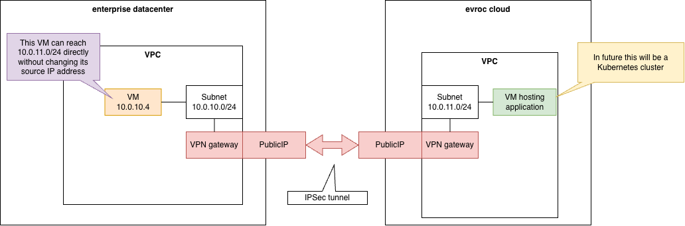
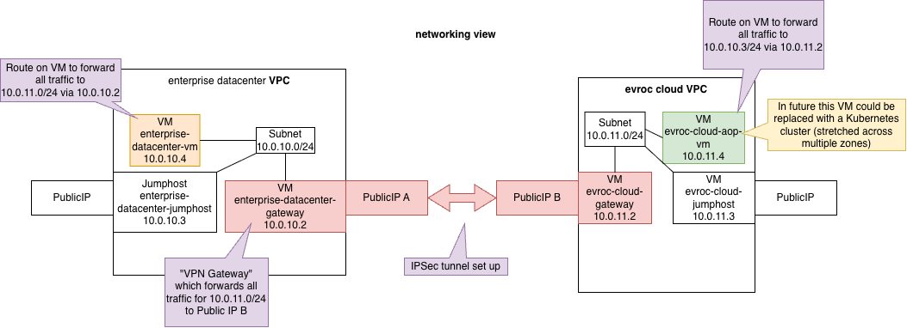
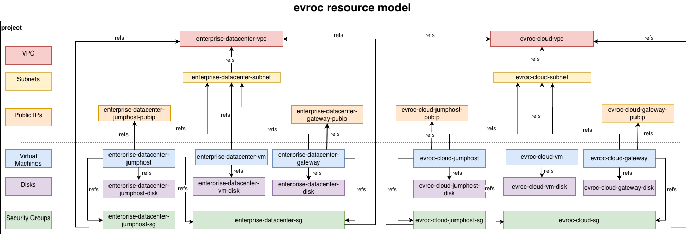

# enterprise-vpn-reference-architecture

This project contains a reference architecture for a VPN gateway, used to
securely connect an enterprise datacenter into an evroc VPC.

To do this, we set up a **VPN gateway** in your datacenter, with a public IP,
and an **IPSec/IKEv2 tunnel** into a peer VM (that has a public IP) in an
evroc VPC.



This project provides a working example of that architecture, where we
emulate an enterprise datacenter by using a second evroc VPC.
We recommend you get this reference deployment set up between two VPCs in
evroc's cloud before you connect your datacenter to evroc's VPC via IPSec.

## Quick start

```bash
# Generate an admin ssh keypair + the agreed IPSec PSK
./01-generate-secrets.sh

# Assuming you have the evroc CLI installed, log in and create a project.
# All resources are created in this project.
evroc login
# Deploy the "evroc cloud" side, specifying an allow-SSH range for the
# jumphost VMs (your office/home range).
# Will update your local ~/.ssh/config file with ec-* shortcuts
ALLOW_SSH_CIDR_RANGE=194.14.80.0/24 ./02-deploy-evroc-cloud.sh

# [Optional] deploy the customer datacenter side of the example - this includes:
#   - setting up a VPN Gateway VM
#   - configuring a VM with the relevant routing rules to talk to subnets in
#     evroc's cloud via the VPN Gateway
# Adds the edc-* shortcuts to your ~/.ssh/config
ALLOW_SSH_CIDR_RANGE=194.14.80.0/24 ./03-deploy-enterprise-datacenter.sh

# Setup the IPSec tunnel
./04-setup-ipsec.sh

./05-verify.sh
```

These scripts are idempotent.
`teardown.sh` removes everything but keeps `secrets/`
so a rebuild re-establishes the same identity.


## Topology

The reference architecture uses two separate VPCs ("enterprise-datacenter"
and "evroc-cloud"), with non-overlapping subnets.

Each of these VPCs has a jumphost with a public IP for admin access, and a
VPN gateway with a public IP, which hosts the IPSec tunnel between the VPCs.

The "evroc-cloud" VPC has an "app-vm" running a simple python service which
could be replaced by a private Kubernetes service.

The `05-verify.sh` script shows traffic initiated from a VM in the
"enterprise-datacenter" to an application in the "evroc-cloud" VPC, and the
traffic being routed back; crucially, in the evroc-cloud VPC the source IPs
of traffic appear as though they come from the 10.0.10.0/24.
* enterprise-datacenter-vm curls evroc-cloud-app-vm:8080 through the tunnel
  and the body reports its own enterprise private IP -> **no SNAT anywhere**
* tunnel works backwards too (evroc jumphost pings the enterprise VM)
* exactly one IKE SA + child SA per side, UDP 500/4500 ingress scoped to
  the peer after 04 runs



In terms of evroc resources used to create this, we create various evroc
resources, crucially the two VPCs contain no cross-references, the
connection is solely by the IPSec tunnel.



## The IPSec flow


1. **Agree on the secret** -- `secrets/ipsec.psk` was created by
   01-generate-secrets.sh (kept in `secrets/`, gitignored; survives
   teardowns so both sides keep identity).
2. **Add the tunnel SG rules** -- `allow-ike-from-peer` (UDP/500) and
   `allow-natt-from-peer` (UDP/4500) on both gateway SGs, scoped to the
   peer gateway's public IP `/32`. These are NOT created by the
   `02-deploy-evroc-cloud.sh` and `03-deploy-enterprise-datacenter.sh`
   scripts, because the peer's public IP is not known until both sides
   exist.
3. **Provision** -- `templates/ipsec.conf.tpl` rendered per side and pushed
   over SSH to `/etc/ipsec.conf` + `/etc/ipsec.secrets`. Gateways allow SSH
   from their subnet only, so provisioning goes through the respective
   jumphost. Gateways ship with strongSwan *installed but unconfigured*
   (cloud-init), so this step is the single moment the tunnel is created.
4. **Initialise from the enterprise side** -- the initiator (`auto=start`)
   is pushed last, so the enterprise-datacenter gateway always brings the
   tunnel up. The evroc side is `auto=add` (responder only):
   **both sides initiating at once creates duplicate IKE SAs that
   blackhole traffic** -- found the hard way.
5. Gateways run `forceencaps=yes` (ESP inside UDP/4500) because SG rules
   cannot express IP protocol 50, and `send_redirects=0` (tunnel egress is
   the same interface packets arrive on; redirects poison client route
   caches). MTU: the tunnel adds ~50-70 bytes of encapsulation, so hosts
   install their far-side routes with an `mtu 1300` hint (SYNs then
   advertise MSS <= 1260 in both directions), and the gateways run an MSS
   guardrail (`--set-mss 1260`) as a net for hosts without the hint, e.g.
   phase-2 k8s nodes. (`--clamp-mss-to-pmtu` on the gateway would be a
   no-op here: it reads the 1500 uplink PMTU, not the tunnel's.)

## SSH access

SSH access is only available via the jumphosts, and only from IPs inside
the `ALLOW_SSH_CIDR_RANGE`. Gateways and private VMs accept
SSH from their own subnet only, i.e. via the jump host.
If the `ALLOW_SSH_CIDR_RANGE` environment variable is not set, it defaults
to `0.0.0.0/0` (wide open, with a warning).

The `02-deploy-evroc-cloud.sh` and `03-deploy-enterprise-datacenter.sh`
commands both install a managed block into your local `~/.ssh/config` file,
delimited by BEGIN/END markers -- anything else you keep in that file is
left untouched. The block allows shortcuts such as:

```bash
ssh edc-jumphost      # public jump host, enterprise side
ssh edc-gateway        # enterprise VPN gateway (initiator), VIA edc-jumphost
ssh edc-vm             # private IP VM, via edc-jumphost (also: ssh 10.0.10.x)
ssh ec-jumphost        # public jump host, evroc side (no services on purpose)
ssh ec-gateway         # evroc VPN gateway (responder), VIA ec-jumphost
ssh ec-app-vm          # private app VM via ec-jumphost (also: ssh 10.0.11.x)
```

* The jump hosts hold only the *public* key; hopping onward from their shell
  needs agent forwarding (`ssh -A edc-jumphost`). Never copy private keys
  onto VMs.

## Try it yourself

```bash
source resources.env     # actual allocated IPs, written by the deploy scripts
ssh edc-vm
curl http://$EC_APP_PRIVATE_IP:8080/     # app in the evroc cloud, over the tunnel
hello from evroc-cloud-app-vm - your tunnel source IP is 10.0.10.x   <- no SNAT
```

The app is embedded in the app VM's cloud-init (systemd unit
`enterprise-vpn-app.service`, persists across reboots -- it echoes the
requestor's source IP). Likewise, the evroc-cloud gateway runs a stand-in
"kubeAPI" service on :6443 from its cloud-init (systemd unit
`enterprise-vpn-kubeapi-standin.service`), standing in for a future private
Kubernetes API endpoint.

More poking:

```bash
ssh edc-gateway 'sudo ipsec statusall'                     # tunnel state
ssh edc-gateway 'sudo tcpdump -ni enp1s0 udp port 4500'     # watch encapsulated traffic
ssh ec-jumphost "ping $EDC_VM_PRIVATE_IP"                  # backwards through the tunnel
curl http://$EC_GW_PRIVATE_IP:6443/                        # stand-in kubeAPI, from edc-vm
```
